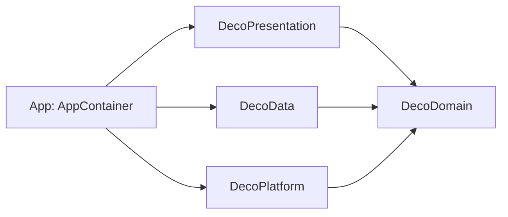

# 0001. Arquitectura y stack: apps nativas por plataforma con clean architecture

## Estado
Accepted (2026-10-25)

## Contexto
DecoDoctor ayuda a empleados de farmacia (y a pacientes o cuidadores) a leer recetas manuscritas.
Requisitos que mandan:
- Procesamiento 100 % en el dispositivo (dato de salud, Ley 25.326) y uso sin conexión.
- Aprovechar lo que trae cada sistema: Vision + Foundation Models en iOS; ML Kit + Gemini Nano en Android.
- iOS primero; Android después, sin reescribir el diseño.
- Equipo de una persona que está aprendiendo: poca complejidad de build, cero dependencias externas.

## Opciones consideradas
1. **Nativo por plataforma** (Swift/SwiftUI ahora, Kotlin/Compose después) con las mismas capas y
   contratos compartidos como datos: diccionario JSON, casos dorados y especificación del dominio.
2. **Kotlin Multiplatform**: dominio y matching en Kotlin compartido; UI nativa en cada plataforma.
3. **Multiplataforma de UI** (Flutter / React Native): una sola base de código.

### Matriz de decisión (1–5, ponderada)

| Criterio | Peso | Nativo | KMP | Flutter/RN |
|---|---:|---:|---:|---:|
| Acceso a Vision / Foundation Models / ML Kit | 25 | 5 | 4 | 2 |
| Simplicidad de build y curva de aprendizaje | 20 | 5 | 2 | 3 |
| Reutilización entre plataformas | 15 | 3 | 5 | 5 |
| Privacidad / superficie de dependencias | 15 | 5 | 4 | 3 |
| Testabilidad del dominio | 15 | 5 | 5 | 4 |
| Alineación con el stack del workspace (Swift) | 10 | 5 | 3 | 2 |
| **Total** | 100 | **4.70** | 3.80 | 3.10 |

## Decisión
Opción 1. Clean architecture con un paquete SwiftPM local (`DecoKit`) y **un target por capa**
(`DecoDomain`, `DecoData`, `DecoPlatform`, `DecoPresentation`), igual que en Treino: el compilador
hace cumplir la regla de dependencias y hay un solo `Package.swift` que mantener. La app es un
composition root delgado.

Lo que se comparte con Android son **datos y contratos**, no código: `shared/dictionary`,
`shared/fixtures` (los mismos casos dorados corren en los dos lados) y `shared/spec/domain.md`.

Stack: Swift 6 (concurrencia estricta), SwiftUI, SwiftData, Vision, VisionKit, Foundation Models,
LocalAuthentication. iOS 26 como mínimo (lo exige Foundation Models). Tests con Swift Testing.

## Consecuencias
- Positivas: acceso directo a las APIs del sistema; dominio portable y testeable en macOS con
  `swift test`; sin dependencias de terceros.
- Negativas: el dominio se escribe dos veces (Swift y Kotlin). Mitigación: el dominio es chico y los
  casos dorados compartidos detectan divergencias.
- Riesgos: que las dos implementaciones se separen con el tiempo → los fixtures son la fuente de verdad.

## Cumplimiento
- Seguridad: sin red, sin SDKs de terceros, Data Protection `complete`, bloqueo opcional con Face ID.
- Calidad (ISO 25010): mantenibilidad por capas; portabilidad vía contratos compartidos.
- Normativa: Ley 25.326 (datos de salud quedan en el dispositivo). La app no dispensa ni valida recetas.

## Referencias
- `docs/arch/pipeline.md`, ADR 0002, ADR 0003.
