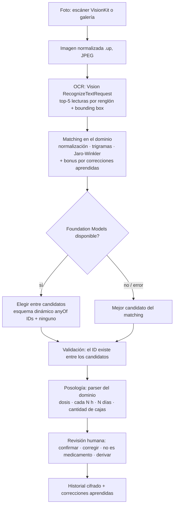

# Pipeline de lectura

## Niveles de confianza

| Nivel | Regla | Qué ve el empleado |
|---|---|---|
| Alta | puntaje ≥ 0,93 y sin empate cercano | Verde. Igual hay que confirmar. |
| Media | puntaje ≥ 0,89, o alta con empate (< 0,03 entre los dos mejores) | Amarillo. Revisar candidatos. |
| Baja | puntaje entre 0,84 (mínimo para sugerir) y 0,89 | Rojo. Sugerencia: derivar al farmacéutico. |

## Equivalencias para Android

| Pieza | iOS | Android |
|---|---|---|
| Captura | VisionKit `VNDocumentCameraViewController` / `PhotosPicker` | ML Kit Document Scanner / Photo Picker |
| OCR | Vision `RecognizeTextRequest` | ML Kit Text Recognition v2 (latín) |
| Interpretación | Foundation Models (`DynamicGenerationSchema`) | ML Kit GenAI Prompt API (Gemini Nano), salida JSON validada contra los candidatos |
| Fallback | Solo matching | Solo matching |
| Persistencia | SwiftData + Data Protection | Room + almacenamiento interno cifrado |
| Bloqueo | LocalAuthentication (Face ID) | BiometricPrompt |
| Dominio | `DecoDomain` (Swift) | módulo `domain` (Kotlin puro) — misma spec |
| Diccionario | `shared/dictionary/medicamentos.json` | el mismo archivo |
| Casos dorados | `shared/fixtures` | los mismos archivos |
